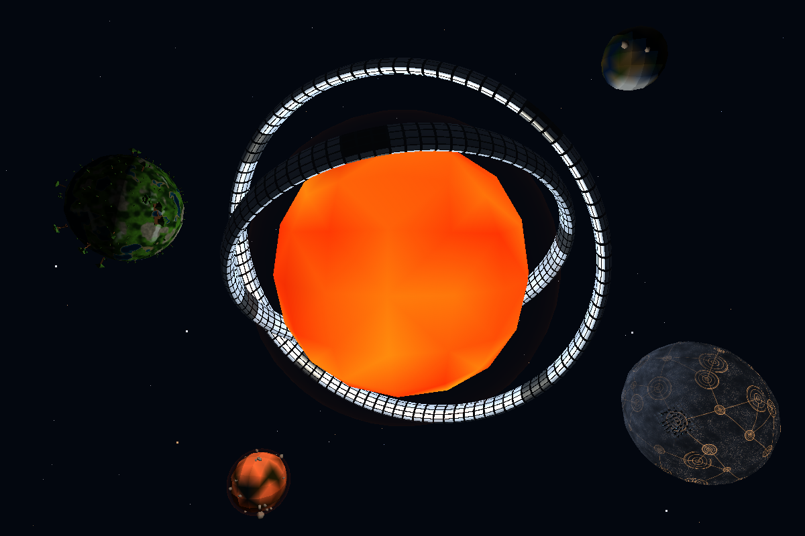
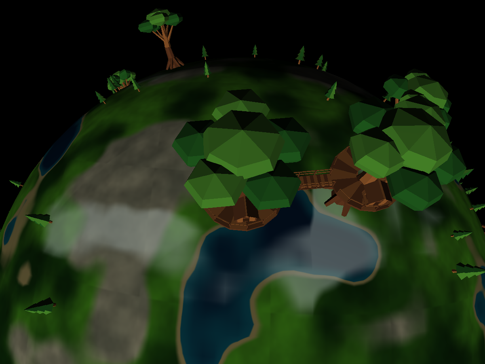
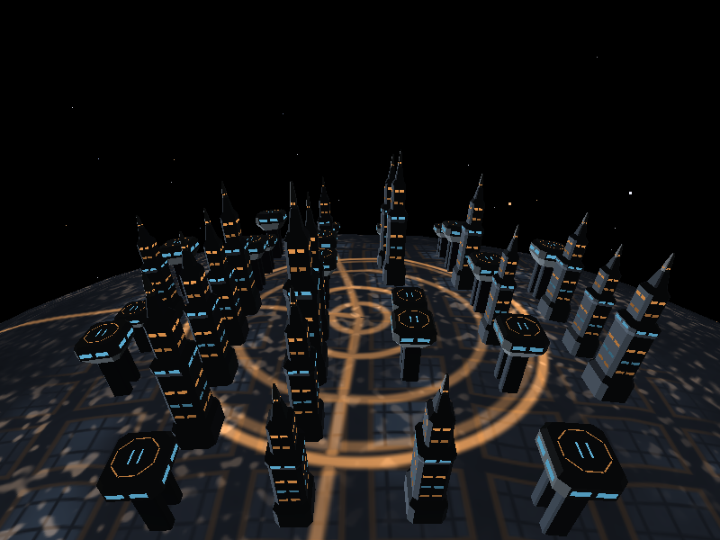
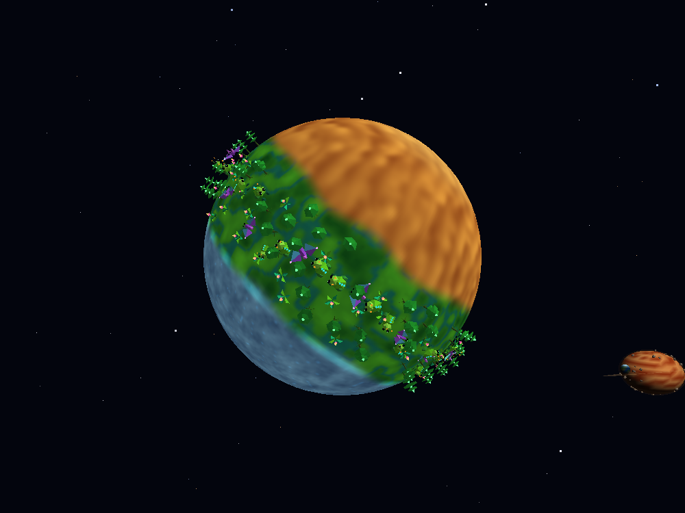
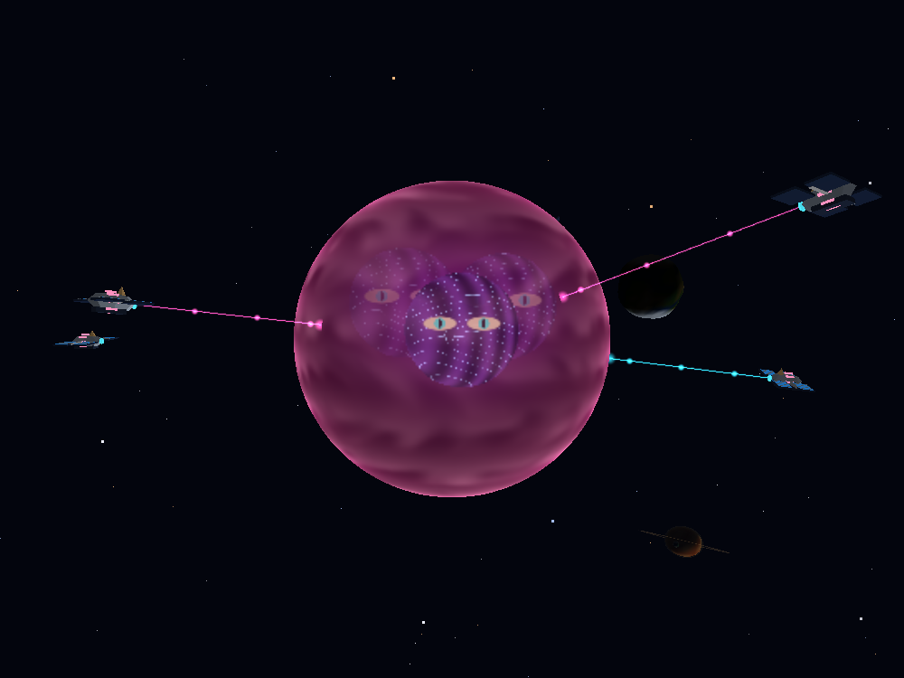
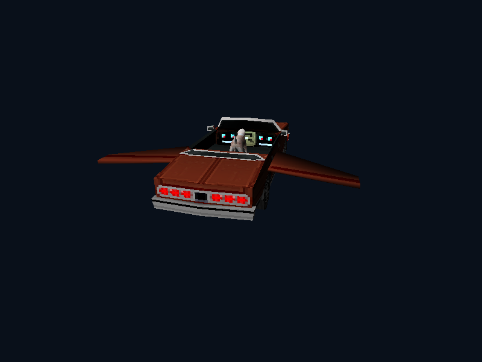
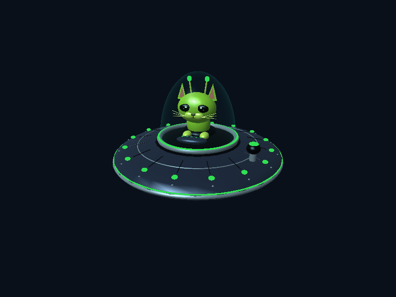
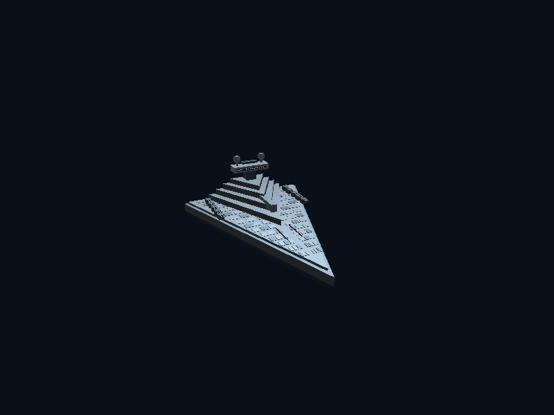
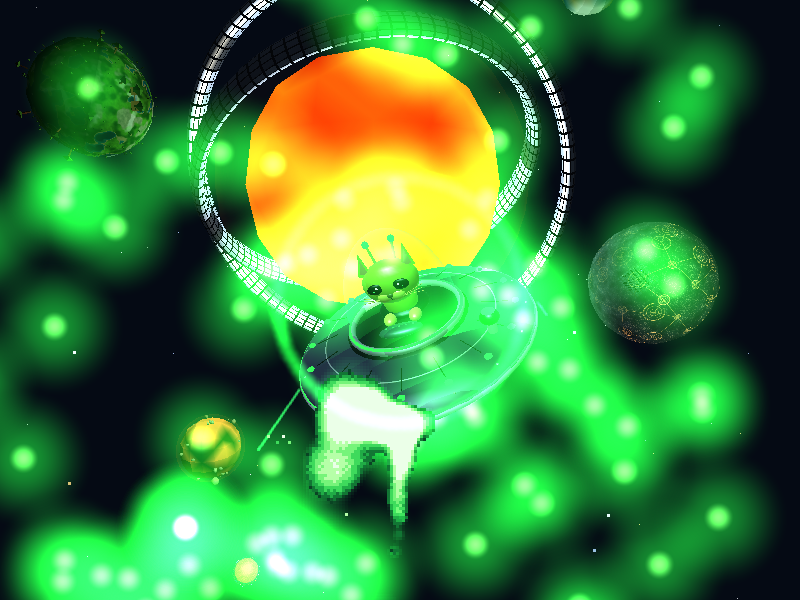
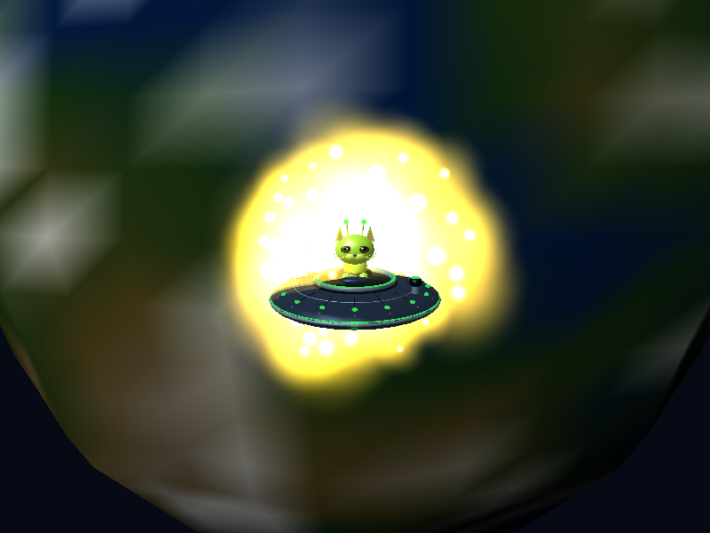

# CC2018 — Proyecto 3: Space Travel

Aplicación en Rust para recorrer un sistema solar con una nave y cámara en tercera persona. La geometría, proyección, rasterización, profundidad y shaders se calculan en CPU con un renderer propio; raylib proporciona la ventana, la entrada y el audio.

## Autores

1. Oscar Rodrigo Rompich Cotzojay - 24880
2. José Manuel Sanchez Hernández - 24092
3. Jorge Andrés Villeda Solís - 24932

## Funcionalidades implementadas

### Sistema solar y mundos explorables

El escenario contiene **32 cuerpos celestes**: los 30 del catálogo base, más Kashyyyk y Coruscant. Incluye estrellas, planetas rocosos, gigantes gaseosos y lunas, con superficies procedurales, atmósferas, anillos y distintas velocidades de rotación. Los planetas orbitan alrededor del sol y las lunas acompañan a sus cuerpos principales. Dos aros Dyson giran alrededor de la estrella central.



Cuatro planetas incorporan detalles propios:

| Mundo | Características |
| --- | --- |
| Kashyyyk | Bosques y una aldea con construcciones sobre la superficie. |
| Coruscant | Ciudad planetaria con torres, edificios y trazados luminosos. |
| Ureski | Desierto, tundra y cinturón templado con flora y dos especies animadas; mantiene una cara orientada al sol. |
| Alfa Riddertal | Gigante gaseoso rosado con núcleo animado y seis estaciones orbitales que intercambian señales luminosas. |

| Kashyyyk: aldea | Coruscant: sobrevuelo |
| --- | --- |
|  |  |

| Ureski: biomas | Alfa Riddertal: núcleo y estaciones |
| --- | --- |
|  |  |


### Vehículos, cámara y navegación

El hangar permite elegir entre **Rampage** (carro espacial), **Jor-Jor Gé** (ovni con piloto felino) y **El Chemax** (destructor estelar). Jor-Jor Gé se construye con geometría propia; El Chemax utiliza modelos OBJ originales del proyecto. La cámara sigue al vehículo, permite orbitar con el ratón y ajustar el zoom. El vuelo admite giro, cabeceo y alabeo en 3D.

El modo de sobrevuelo mantiene una altura sobre un planeta y acompaña su órbita. Jor-Jor Gé y El Chemax también permiten elegir un destino y teletransportarse a una posición libre frente a él. Con `F` se consulta una ficha del cuerpo apuntado.

| Rampage | Jor-Jor Gé | El Chemax |
| --- | --- | --- |
|  |  |  |

### Efectos e interacción

- **Jor-Jor Gé:** `achu` activa una aceleración caótica con partículas y estela verde; `mishmish` activa dianas orbitales que se destruyen con disparos.
- **Rampage:** faros, luces de frenado, radio MP3, introducción cinematográfica y láseres capaces de destruir planetas. Al destruir todos, puede atacar el sol y reiniciar el sistema.
- **El Chemax:** `B` fija un planeta cercano y abre la bahía; pulsaciones repetidas de `J` cargan el reactor durante al menos 15 segundos. Una confirmación permite lanzar la bomba, que genera grietas, una onda expansiva y escombros. `F8` restaura los planetas al terminar la secuencia.
- **Colisiones:** se comprueba el recorrido del volumen de la nave para evitar atravesar cuerpos celestes a alta velocidad. El choque produce rebote, destello, partículas, sonido y sacudida de cámara. La cámara también ajusta su posición para evitar penetrar los cuerpos.

| Jor-Jor Gé durante `achu` | Impacto contra un planeta |
| --- | --- |
|  |  |

## Cumplimiento de la rúbrica

Los estados describen la implementación y la evidencia disponible; la puntuación final corresponde al evaluador. Los dos criterios subjetivos son **rendimiento y estética** (30 y 20 puntos en la rúbrica; la imagen no especifica cuál peso corresponde a cada uno).

| Criterio | Máximo | Implementación y evidencia |
| --- | ---: | --- |
| Rendimiento y estética (subjetivos) | 50 (30 + 20) | Se presentan optimizaciones y decisiones visuales abajo; sujetos a evaluación. |
| Planetas, estrellas o lunas: 5 elementos | 50 | Implementado: 32 cuerpos. Las capturas muestran, entre otros, el sol, Kashyyyk, Coruscant, Ureski y Alfa Riddertal. |
| Warping | 20 | Parcial respecto al criterio: existe teletransporte con `3.14`, pero el salto es instantáneo. No se acredita el efecto animado de warping; la equivalencia con los 10 puntos por implementación queda a criterio del evaluador. |
| Nave modelada por el equipo que siga la cámara | 30 | Modelos propios de Jor-Jor Gé y El Chemax, con cámara de seguimiento en tercera persona. Se muestran arriba; el seguimiento se verifica durante el vuelo. |
| Skybox con estrellas en el horizonte | 10 | Fondo estelar procedural de 600 estrellas en tres capas con parallax, visible en las capturas. Cumple la función visual mediante puntos proyectados, sin un cubo de texturas. |
| Condicionales que eviten atravesar elementos | 10 | Barrido de colisiones para la nave y ajuste de cámara; el impacto se muestra arriba. Usa volúmenes esféricos conservadores, sin colisión por triángulo con árboles, edificios o anillos. |
| Movimiento 3D de cámara | 40 | Seguimiento de la orientación, órbita con ratón y zoom; se comprueba con los controles de vuelo. |
| Órbitas de planetas | 20 | Actualización temporal de planetas y lunas con ejes y velocidades propios; visible al dejar avanzar la simulación. |

### Rendimiento

El renderer usa descarte de objetos fuera de cámara, descarte de caras, prueba de profundidad y niveles de detalle según distancia. Los mundos detallados reducen geometría lejana; Ureski reutiliza un mapa de biomas y descarta vida detrás del horizonte, mientras Alfa Riddertal utiliza una caché de sombreado por cuadro. El audio de la radio se procesa en un hilo independiente.

Se dispone de un benchmark de 240 cuadros a 800 × 600 que informa tiempo medio, percentil 95, FPS de CPU y contadores de geometría y fragmentos:

```bash
cargo run --release -- --benchmark --objects 30
```

Estas métricas miden trabajo de CPU en una escena de prueba; no garantizan los mismos FPS durante el juego. El costo aumenta al acercarse a superficies con mucho detalle.

## Ejecución y controles

Se requiere **Rust/Cargo compatible con la edición 2024**, CMake, un compilador C/C++ y LLVM/libclang para compilar las dependencias nativas de raylib. En Windows, instala también las herramientas C++ de Visual Studio; en macOS, las herramientas de línea de comandos de Xcode.

Desde la raíz del repositorio, para que se encuentren los recursos de `assets/`:

```bash
cargo run --release
```

Selecciona `1` para Rampage, `2` para Jor-Jor Gé o `3` para El Chemax y pulsa `Enter` para despegar.

| Control | Acción |
| --- | --- |
| `S` / `W`, `A` / `D`, `Q` / `E` | Subir/bajar el morro, girar y realizar alabeo. |
| `Espacio` / `Shift izquierdo` | Acelerar / frenar. |
| Clic derecho + ratón / rueda | Orbitar la cámara / zoom. |
| `L` cerca de un planeta | Entrar o salir del sobrevuelo; en este modo, `W/S` ajustan altura y `A/D` el rumbo. |
| `F` | Inspeccionar el cuerpo apuntado. |
| Escribir `3.14` sin Enter | Abrir destinos con Jor-Jor Gé o El Chemax; flechas y `Enter` para viajar. |
| Clic izquierdo | Disparar con Rampage o con Jor-Jor Gé en `mishmish`. |
| `R` / `achu` / `mishmish` | Pirueta / aceleración especial / modo de dianas de Jor-Jor Gé. |
| Escribir `fm` | Mostrar u ocultar la radio de Rampage; archivos MP3 en `assets/radio/`. |
| `B`, pulsaciones de `J` | Fijar objetivo y cargar la bomba de El Chemax; confirmar con flechas y `Enter`. |
| `F1` / `F10` / `F11` | Regresar al hangar / alternar CRT / pantalla completa. |
| `Esc` | Cancelar un menú o la carga del arma; durante el vuelo normal, salir. |

Para una demostración rápida, elige Jor-Jor Gé, escribe `3.14`, visita uno de los cuatro mundos principales y activa `L`. Prueba el giro, zoom, inspección y frenado; repite en otro mundo para comparar superficies y órbitas.

Las capturas incluidas se generaron con los modos existentes `--preview-ships`, `--preview-dyson`, `--preview-persona3`, `--preview-alien`, `--benchmark-coruscant --capturas` y `--benchmark-kashyyyk --capturas`. Estos guardan los originales en `target/`; la selección documentada se conserva en [`demo/`](demo/).

Los modelos originales de Jor-Jor Gé, El Chemax, flora, fauna y estaciones se desarrollaron para el proyecto con asistencia de Codex/IA.
