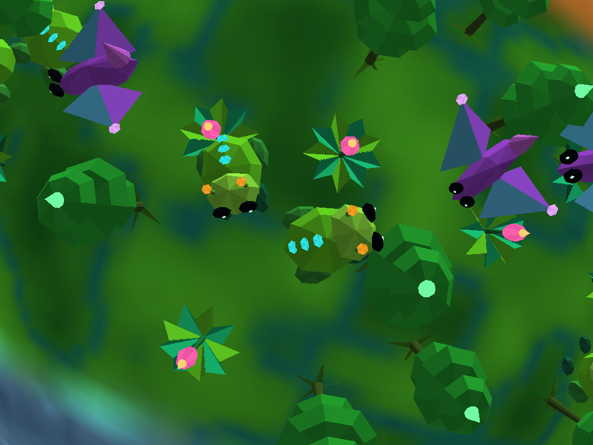

# Gráficas por Computadora - Proyecto final: Space Travel

**Enlace al video del funcionamiento:**

Aplicación en Rust para explorar un sistema solar desde una nave. Permite viajar por el espacio, acercarse a los planetas, rodearlos y alejarse sin cambiar de escena. Incluye tres vehículos, superficies distintas, construcciones, vegetación y efectos animados.

La escena 3D se calcula en CPU con un renderizador propio: carga de modelos, transformaciones, proyección, rasterización, color y profundidad. Raylib proporciona la ventana, las entradas, el audio y la presentación de la imagen final.


## Integrantes y contribuciones

Resumen de las contribuciones registradas en los commits de cada integrante. Algunas funciones recibieron cambios de más de una persona.

| Nombre | Carné | Contribución técnica |
| --- | --- | --- |
| Oscar Rodrigo Rompich Cotzojay | 24880 | Renderizador por software, optimizaciones y mediciones de rendimiento. Sistema solar base, órbitas, atmósferas, anillos y colisiones. Movimiento inicial de la nave, armas de Rampage, introducción y efectos de ambientación. |
| José Manuel Sanchez Hernández | 24092 | Kashyyyk y Coruscant: superficies, árboles, aldea, edificios y mejoras de rendimiento. Modelos de El Chemax, bomba y destrucción de planetas. Ajustes del sobrevuelo, organización del movimiento y regreso al hangar. |
| Jorge Andrés Villeda Solís | 24932 | Jor-Jor Gé, piloto felino, modos especiales, viaje rápido y efectos de impacto. Ureski y Alfa Riddertal con sus modelos y shaders, control local de vuelo, aros Dyson y radio del carro. |

## Instalación y ejecución

### Herramientas necesarias

- Git para descargar el repositorio.
- Rust y Cargo compatibles con la edición 2024.
- CMake y un compilador de C/C++ para las dependencias nativas de raylib.
- LLVM/libclang para generar los enlaces con raylib.
- En Windows, las herramientas de compilación de Visual Studio con el componente de C++.

### Descargar el proyecto

Abre una terminal y ejecuta:

```bash
git clone https://github.com/oscarligo/CC2018-P3.git
cd CC2018-P3
```

Conserva la carpeta `assets/`, ya que contiene los modelos, texturas y audios necesarios.

### Compilar y ejecutar

Desde la raíz del proyecto, ejecuta:

```bash
cargo run --release
```

Cargo descarga y compila las dependencias durante la primera ejecución, por lo que necesita conexión a internet y puede tardar más. Se utiliza `release` para optimizar el renderizado en CPU.

Para compilar sin abrir la aplicación:

```bash
cargo build --release
```

Ejecuta siempre el programa desde la raíz del repositorio para que encuentre los recursos de `assets/`.

En el hangar, selecciona `1` para Rampage, `2` para Jor-Jor Gé o `3` para El Chemax. Pulsa `Enter` para despegar.

## Controles

| Control | Acción |
| --- | --- |
| `S` / `W` | Subir o bajar el morro de la nave. |
| `A` / `D` | Girar a la izquierda o a la derecha. |
| `Q` / `E` | Inclinar lateralmente la nave. |
| `Espacio` / `Shift izquierdo` | Acelerar o frenar. |
| Clic derecho y movimiento del ratón | Girar la cámara alrededor de la nave. |
| Rueda del ratón | Acercar o alejar la cámara. |
| `L` cerca de un planeta | Activar o desactivar el sobrevuelo. En este modo, `W/S` orientan la nave para cambiar de altura y `A/D` ajustan el rumbo. |
| `F` | Consultar la ficha del cuerpo apuntado. |
| Escribir `3.14` | Abrir destinos con Jor-Jor Gé o El Chemax. Elegir con las flechas y confirmar con `Enter`. |
| Clic izquierdo | Disparar con Rampage o con Jor-Jor Gé en el modo de dianas. |
| `R` con Jor-Jor Gé | Realizar una pirueta. |
| Escribir `achu` con Jor-Jor Gé | Activar una aceleración especial con partículas y estela verde. |
| Escribir `mishmish` con Jor-Jor Gé | Activar el modo de dianas orbitales. |
| Escribir `fm` con Rampage | Mostrar u ocultar la radio. Sus botones se manejan con el ratón. |
| `B` con El Chemax | Fijar un planeta cercano y abrir la bahía de la bomba. |
| Pulsar `J` repetidamente con El Chemax | Cargar el reactor durante al menos 15 segundos. Después, elegir y confirmar el lanzamiento con flechas y `Enter`. |
| `F8` con El Chemax | Restaurar los planetas al terminar la secuencia de destrucción. |
| `F1` | Regresar al hangar para cambiar de vehículo. |
| `F10` / `F11` | Alternar el efecto CRT o la pantalla completa. |
| `Esc` | Cancelar el menú de viaje o la carga del arma. Durante el vuelo normal, salir. |

Los comandos escritos, como `3.14`, `achu`, `mishmish` y `fm`, se activan al completar la secuencia, sin pulsar `Enter`.

## Implementación

| Requisito | Implementación y ubicación |
| --- | --- |
| Pipeline de software propio | `src/rendering/` transforma, proyecta y rasteriza la geometría. El framebuffer resuelve color y profundidad. La escena no utiliza el renderizado 3D ni la física de un motor externo. |
| Sol, nave propia y planeta con órbita y rotación | El sistema incluye estos elementos. Jor-Jor Gé se genera con geometría propia y El Chemax utiliza modelos propios. Los movimientos dependen del tiempo transcurrido entre cuadros. |
| Acercamiento y alejamiento sin cambiar de escena | El vuelo libre y el sobrevuelo permiten recorrer los planetas dentro del mismo mundo, con control de la nave y la cámara. |
| Modelos, transformaciones y shader de fragmentos propio | Se cargan archivos OBJ y se aplican transformaciones de modelo, vista y proyección, con prueba de profundidad. Kashyyyk, Coruscant y Ureski tienen sombreado propio por fragmento. |
| Código, recursos, instrucciones y video | El código está en `src/`, los recursos en `assets/` y las instrucciones en este documento. El enlace del video queda pendiente. |

## Características solicitadas para evaluación

Estas características se incluyen para evaluación, con su ubicación en el proyecto.

| Sección | Característica | Máximo | Dónde observarla |
| --- | --- | ---: | --- |
| Planetas | Cinco planetas distinguibles con órbita, rotación y vista cercana | 50 | Kashyyyk, Coruscant, Ureski, Alfa Riddertal y Protoplaneta, descritos abajo. |
| Superficie | Cuatro tipos de modelos propios | 20 | Plantas de copa, helechos y dos especies de fauna de Ureski. Se generan en `src/scene/planets/exploration/models.rs`. |
| Superficie | Distribución reproducible con ruido y semilla | 10 | Vida de Ureski, bosque de Kashyyyk y edificios de Coruscant. Las mismas semillas producen las mismas ubicaciones. |
| Superficie | Posición y orientación sobre la superficie curva | 5 | Árboles, edificios y vida de los planetas siguen la transformación del cuerpo y se orientan hacia afuera de su superficie. |
| Renderizado | Cuatro shaders propios con efectos distintos | 24 | Bosques de Kashyyyk, ciudad de Coruscant, biomas de Ureski y volumen gaseoso de Alfa Riddertal. |
| Renderizado | Shader animado | 8 | Nubes y núcleo de Alfa Riddertal, cuyo efecto cambia con el tiempo. |
| Renderizado | Deformación de la geometría de un planeta | 10 | Relieve de Protoplaneta. `shape_radius` en `src/objects/celestial.rs` modifica la geometría mediante ruido. |
| Renderizado | Generación de geometría antes de rasterizar | 10 | Mallas de cuerpos celestes y modelos de Ureski construidos en CPU a partir de vértices y triángulos. |
| Navegación | Control local para rodear un planeta | 8 | Activar `L` cerca de un planeta y recorrer su superficie. |
| Navegación | Aceleración, frenado y giro progresivos | 8 | Controles de vuelo calculados con el tiempo entre cuadros en `src/ship/movement/navigation.rs`. |
| Navegación | Colisión básica con planetas | 4 | Acercarse a un planeta en vuelo libre. El barrido de colisiones evita atravesarlo y genera la respuesta de impacto. |
| Rendimiento | Descarte de objetos fuera de vista | 7 | Comparación de Kashyyyk con descarte activado y desactivado. |
| Rendimiento | Niveles de detalle según la distancia | 8 | Acercamiento y alejamiento de planetas. La comparación de Kashyyyk muestra cambios en los triángulos procesados. |
| Presentación | Coherencia visual y composición | 5 | Vista del sistema, identidad de planetas, vehículos y efectos. |
| Presentación | Claridad de controles y recorrido | 5 | Hangar, selección de destinos, fichas de planetas y controles descritos en este documento. |

No se implementa mapeo de normales ni atracción gravitatoria sobre la nave. El sobrevuelo es una ayuda de navegación, no una simulación de gravedad. Las colisiones usan volúmenes aproximados de los cuerpos celestes y no comprueban cada triángulo de árboles o edificios.

### Planetas y superficies

El escenario contiene 32 cuerpos celestes entre estrellas, planetas y lunas. Estos son cinco de los planetas que se pueden explorar:

| Planeta | Elementos visibles |
| --- | --- |
| Kashyyyk | Bosques, árboles gigantes y una aldea con plataformas, puentes y viviendas. |
| Coruscant | Ciudad planetaria con edificios, torres y trazados luminosos. |
| Ureski | Desierto, tundra y una franja templada con flora y dos especies animadas. Su orientación acompaña la órbita para mantener una cara hacia el sol. |
| Alfa Riddertal | Gigante gaseoso rosado con núcleo animado y seis estaciones orbitales que intercambian señales luminosas. |
| Protoplaneta | Cuerpo rocoso con silueta irregular y rocas sobre la superficie. El relieve modifica la malla, además del color. |


| Kashyyyk | Coruscant |
| --- | --- |
|  |  |

| Ureski | Alfa Riddertal |
| --- | --- |
|  |  |



Los shaders de Kashyyyk y Coruscant están en sus respectivas carpetas dentro de `src/scene/planets/`. Los de Ureski y Alfa Riddertal están en `src/scene/planets/exploration/surface.rs`. Producen patrones de bosque, distribución urbana, regiones climáticas y un volumen de gas con núcleo, respectivamente.

### Vehículos y funciones adicionales

| Rampage | Jor-Jor Gé | El Chemax |
| --- | --- | --- |
|  |  |  |

- **Rampage:** carro espacial con faros, luces de frenado, radio MP3 e introducción cinematográfica. Sus láseres pueden destruir planetas. Tras destruirlos todos, puede atacar el sol y reiniciar el sistema.
- **Jor-Jor Gé:** ovni con piloto felino, piruetas, aceleración especial y un modo de disparo a dianas.
- **El Chemax:** destructor con una bomba que requiere fijar un objetivo, cargar el reactor y confirmar el lanzamiento. El impacto produce grietas, una onda expansiva y escombros.
- **Viaje rápido:** Jor-Jor Gé y El Chemax permiten elegir un destino y aparecer en una posición libre frente a él.
- **Ambientación:** fondo de 600 estrellas, atmósferas, anillos, dos aros Dyson alrededor del sol y efectos de sonido.
- **Impactos:** rebote, destello, partículas y sacudida de cámara al chocar con un cuerpo celeste.

| Aceleración especial | Colisión |
| --- | --- |
|  |  |

### Comparación de rendimiento

El renderizador descarta objetos fuera de cámara y caras no visibles, comprueba profundidad y ajusta el detalle según la distancia. Ureski reutiliza un mapa de biomas y descarta vida detrás del horizonte; Alfa Riddertal reutiliza cálculos de sombreado dentro de cada cuadro.

Para demostrar el efecto del descarte y de los niveles de detalle, ejecuta:

```bash
cargo run --release -- --benchmark-kashyyyk
```

El comando compara cuatro vistas: espacio, acercamiento, aldea y superficie. En cada una prueba las combinaciones de descarte y niveles de detalle activados o desactivados. Imprime promedios de triángulos, objetos descartados, fragmentos procesados y tiempos de renderizado. Compara las filas de una misma vista para observar el efecto de cada optimización.

Para guardar también capturas en `target/kashyyyk/`:

```bash
cargo run --release -- --benchmark-kashyyyk --capturas
```

También se incluyen mediciones del sistema general y de Coruscant:

```bash
cargo run --release -- --benchmark --objects 30
cargo run --release -- --benchmark-coruscant
```

Los resultados dependen del equipo y de la escena. Miden trabajo de CPU y no garantizan los mismos cuadros por segundo durante el juego.

## Organización del proyecto

| Ruta | Contenido |
| --- | --- |
| `Cargo.toml` y `Cargo.lock` | Dependencias y configuración de compilación. |
| `src/main.rs` | Inicio, ciclo principal y modos de demostración. |
| `src/rendering/` | Carga de modelos y renderizado por software. |
| `src/celestial_shaders/` | Apariencia de estrellas y planetas. |
| `src/objects/` | Catálogo, geometría, atmósferas, anillos y aros Dyson. |
| `src/scene/` | Mundo, órbitas, fondo estelar y escombros. |
| `src/scene/planets/` | Superficies y elementos de los planetas detallados. |
| `src/ship/` | Vehículos, cámara, controles, menús, audio y efectos. |
| `src/ship/movement/` | Vuelo, sobrevuelo, viajes y colisiones. |
| `src/physics/` | Consultas y volúmenes de colisión. |
| `src/interaction/` | Selección e inspección de cuerpos celestes. |
| `src/noise.rs` | Funciones de ruido. |
| `src/performance.rs` | Contadores y mediciones de rendimiento. |
| `src/display.rs` | Presentación de la imagen, pantalla completa y CRT. |
| `assets/` | Modelos, texturas, materiales y audio. |
| `demo/` | Capturas utilizadas en este documento. |

## Recursos externos y asistencia de IA

### Recursos externos

| Recurso | Fuente | Modificaciones |
| --- | --- | --- |
| Modelo del carro | [PSX Style Cars de GGBot](https://ggbot.itch.io/psx-style-cars) | Ligeras modificaciones en Blender. |
| Modelo del perro | [PS1 Dog en Sketchfab](https://sketchfab.com/3d-models/ps1-dog-0406e98056b2465aab3faa0b0b451841) | Ligeras modificaciones en Blender. |
| Biblioteca de efectos de sonido | [The Sounds Resource](https://sounds.spriters-resource.com/) | Utilizada como fuente de efectos de sonido. |

Las dependencias se declaran en `Cargo.toml` y sus versiones se registran en `Cargo.lock`.

### Asistencia de IA

Se utilizó Codex como herramienta de asistencia de IA en el proyecto.
