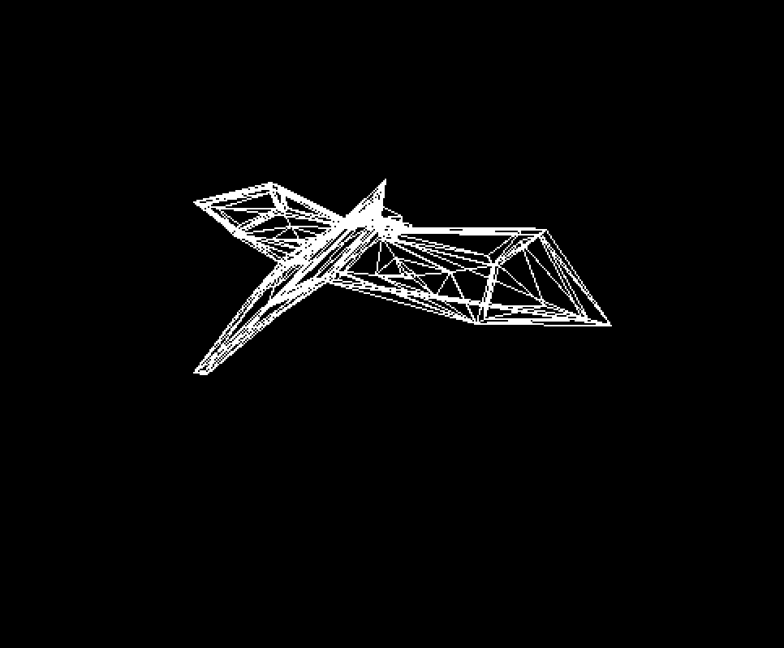
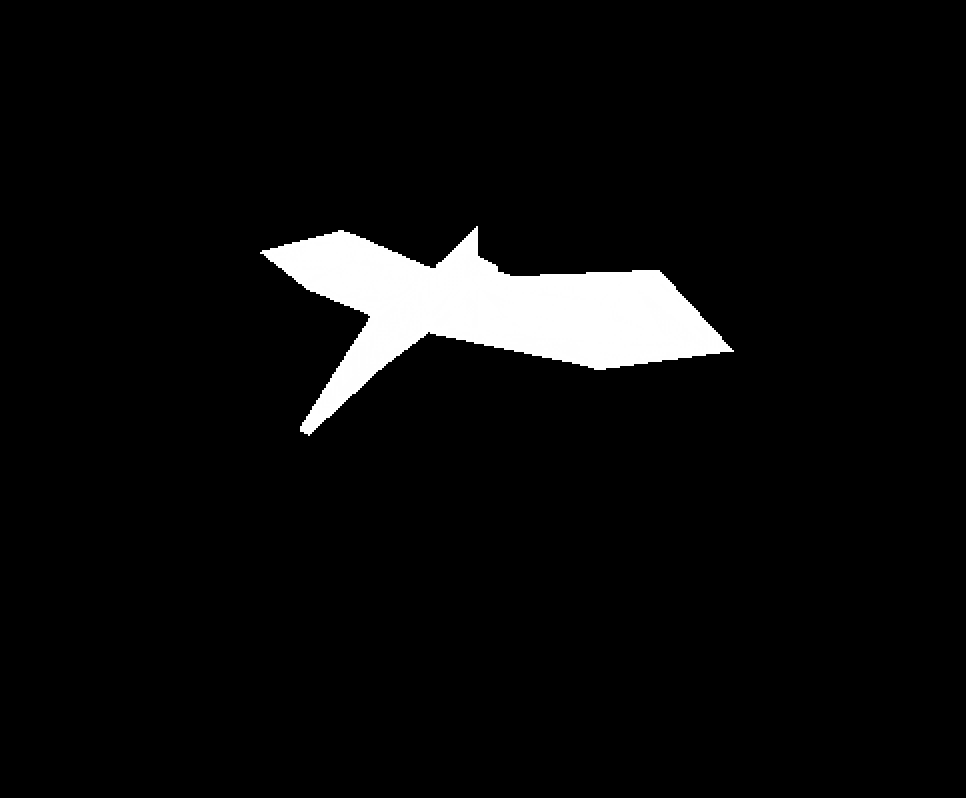
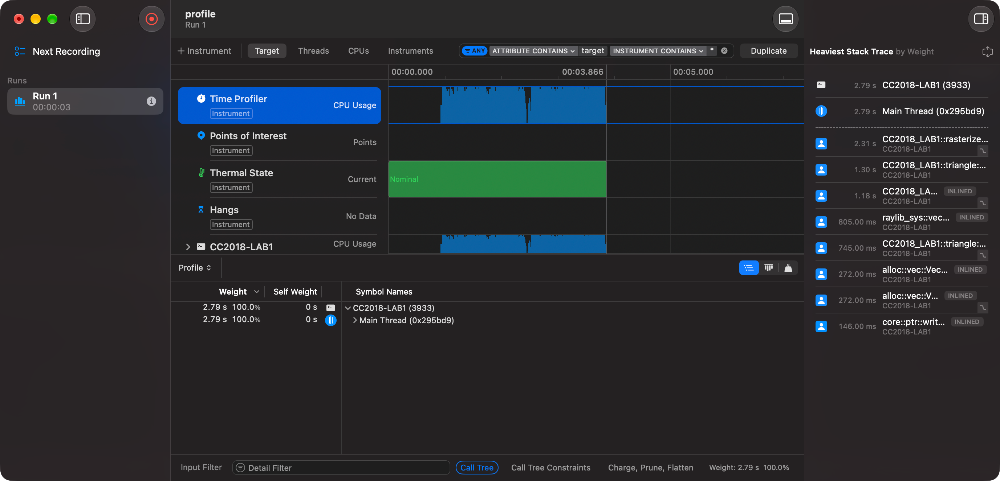

# CC2018 - LAB5

## Rasterización de triángulos

El renderer procesa los vértices, los ensambla en triángulos, los rasteriza y procesa cada fragmento antes de escribirlo en el framebuffer. La rasterización ofrece tres modos:

- `Wireframe`: dibuja las tres aristas con Bresenham.
- `FilledBarycentric`: evalúa coordenadas baricéntricas en el centro de cada píxel.
- `FilledScanline`: encuentra el tramo interior del triángulo en cada fila.

## Resultados visuales

### Wireframe



### Relleno con coordenadas baricéntricas



### Relleno con scanlines


## Mediciones

Las mediciones se realizaron en modo optimizado, ejecutando cada algoritmo 100 veces sobre el mismo triángulo y tomando la mediana de siete repeticiones.

| Algoritmo | Mediana para 100 ejecuciones | Fragmentos |
|---|---:|---:|
| Coordenadas baricéntricas | 197.943584 ms | 161100 |
| Scanlines | 167.425 ms | 161100 |

El modo scanline fue aproximadamente 15.4% más rápido en esta medición. Ambos algoritmos produjeron la misma cantidad y las mismas posiciones de fragmentos en las pruebas, por lo que la diferencia no se debe a que uno omita parte del triángulo.

El algoritmo baricéntrico recorre todo el rectángulo delimitador y evalúa tres pesos para cada posición. Scanline calcula dos intersecciones por fila y solo recorre el tramo interior. Esto reduce el trabajo realizado fuera del triángulo, aunque ambos siguen creando y almacenando el mismo resultado final.

## Perfil de rendimiento



```bash
cargo flamegraph --release -- --benchmark-triangles
```

## Ejecución

Durante la ejecución, las flechas izquierda y derecha rotan el objeto alrededor del eje Y; las flechas arriba y abajo lo rotan alrededor del eje X. Las teclas `W`, `A`, `S` y `D` conservan el control de la cámara.

```bash
# Relleno baricéntrico, modo predeterminado
cargo run --release

# Relleno por scanlines
cargo run --release -- --scanline

# Solo contorno
cargo run --release -- --wireframe

# Comparación de rendimiento sin abrir la ventana
cargo run --release -- --benchmark-triangles
```
